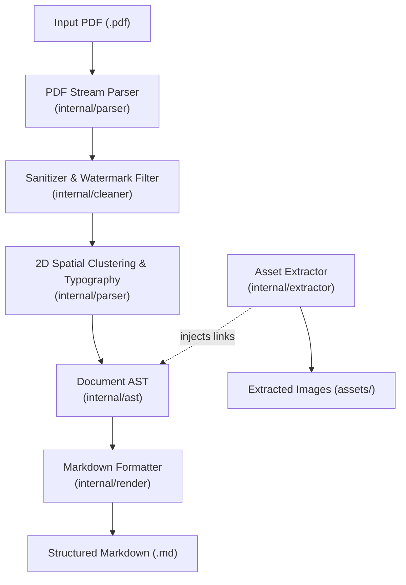

# pdf2md

[](https://github.com/aserron/pdf2md/actions/workflows/ci.yml)
[](https://golang.org)
[](#)
[](LICENSE)

A high-performance, modular PDF to Markdown engine written in pure Go. Engineered for sub-second conversions, clean typographic hierarchy, intelligent watermark sanitization, embedded image extraction, automated table formatting, and cross-platform flexibility across both CLI and native Windows desktop environments.

---

## Key Features

- **Blazing Performance & Zero External Runtime Dependencies**: Built with 100% pure Go. Single standalone binary with zero Cgo, Poppler, or DLL prerequisites.
- **Dynamic Font Scale Clustering**: Automatically calculates document-wide font distributions to identify body text and maps proportional heading levels (`#` through `######`) without hardcoded font size assumptions.
- **Typographic Preservation**: Detects font weights, slants, and monospace characteristics to generate accurate bold (`**...**`), italic (`*...*`), inline code (` `...` `), and fenced code blocks (` ``` `).
- **Intelligent Watermark & Margin Cleaner**: Automatically removes invasive confidential/draft watermarks and scrubs repetitive margin headers, footers, and pagination indicators.
- **Asset & Image Extraction**: Losslessly dumps embedded raster images (`PNG`, `JPEG`, `TIFF`) into an assets directory and injects relative Markdown image references.
- **Automatic Table Recognition**: Detects horizontal column alignment gaps across consecutive rows and emits valid GitHub Flavored Markdown (GFM) tables.
- **Dual Interfaces**:
  - **High-Throughput CLI (`cmd/pdf2md`)**: Supports single-file conversion, worker-pool concurrent batch directory processing, JSON structural inspection, and clean stdout piping.
  - **Windows Desktop GUI (`cmd/pdf2md-gui`)**: Purpose-driven, distraction-free desktop app window with drag-and-drop, options checklist, and live side-by-side Markdown preview.

---

## Architecture Overview



---

## Quickstart

### Prerequisites
- [Go 1.22+](https://go.dev/dl/)
- Make (GNU Make on Windows/Linux)

### Build
```bash
# Build both CLI and Windows GUI binaries into bin/
make build
```

### CLI Usage
```bash
# Convert a single PDF file
pdf2md -i document.pdf -o document.md

# Convert with image extraction and custom regex redaction
pdf2md -i report.pdf -o report.md --images --image-dir assets/ --strip "\[UUID:[^\]]+\]"

# Stream directly to standard output
pdf2md -i report.pdf --quiet > report.md

# Inspect PDF structure and metadata without converting
pdf2md -i report.pdf --inspect

# Batch convert an entire folder of PDFs
pdf2md -i ./manuals/ -o ./converted/
```
👉 *See [docs/cli-guide.md](docs/cli-guide.md) for full flag documentation and examples.*

### Windows Desktop GUI
```powershell
# Launch the Windows desktop application
make run-gui
# Or directly:
go run ./cmd/pdf2md-gui
```
👉 *See [docs/gui-guide.md](docs/gui-guide.md) for GUI usage and drag-and-drop instructions.*

---

## Programmatic Go API

`pdf2md` can be integrated directly into your Go applications and microservices:

```go
package main

import (
    "context"
    "fmt"
    "log"

    "github.com/aserron/pdf2md/pkg/pdf2md"
)

func main() {
    engine := pdf2md.NewEngine()
    opts := pdf2md.DefaultOptions()

    res, err := engine.ConvertFile(context.Background(), "document.pdf", opts)
    if err != nil {
        log.Fatal(err)
    }

    fmt.Printf("Pages: %d | Cleaned Artifacts: %d\n", res.PageCount, res.CleanedRows)
    fmt.Println(res.Markdown)
}
```
👉 *See [docs/api.md](docs/api.md) for full Go library documentation.*

---

## Makefile Targets

| Command | Description |
| :--- | :--- |
| `make build` | Compiles both `pdf2md` and `pdf2md-gui` binaries into `bin/`. |
| `make test` | Runs the full verification test suite. |
| `make bench` | Runs performance benchmarks (`go test -bench`). |
| `make run-cli` | Runs CLI `--help`. |
| `make run-gui` | Launches the Windows desktop GUI application. |
| `make clean` | Removes compiled binaries and build artifacts. |

---

## Engineering Standards

This project adheres strictly to:
- **Ponytail (Simplicity & YAGNI)**: Minimal surface area, standard library first, zero speculative abstractions, atomic self-checks. See [.agents/rules/ponytail.md](.agents/rules/ponytail.md).
- **Anti-Slop (Human Design & Prose)**: Purpose-driven UI, zero marketing buzzwords or AI fluff, and code comments explaining *why* rather than *what*. See [.agents/rules/antislop.md](.agents/rules/antislop.md).
- **Workflow & Branching**: Phased feature branches (`feat/<index>-<desc>`) merged via documented GitHub Pull Requests and preserved locally for evolutionary study. See [.agents/rules/workflow.md](.agents/rules/workflow.md).

---

## Project Documentation
- [Architecture & Design Specification](docs/architecture.md)
- [CLI User Guide](docs/cli-guide.md)
- [Windows GUI Guide](docs/gui-guide.md)
- [Programmatic Go API](docs/api.md)
- [ADR 001: Pure Go vs Cgo Parser Choice](docs/adr/001-pure-go-parser-selection.md)
- [ADR 002: Spatial Margin & Watermark Heuristics](docs/adr/002-watermark-margin-heuristics.md)
- [ADR 003: Standalone Windows App-Mode GUI](docs/adr/003-windows-app-mode-gui.md)

---

## License

MIT © [Andres Serron](https://github.com/aserron)
