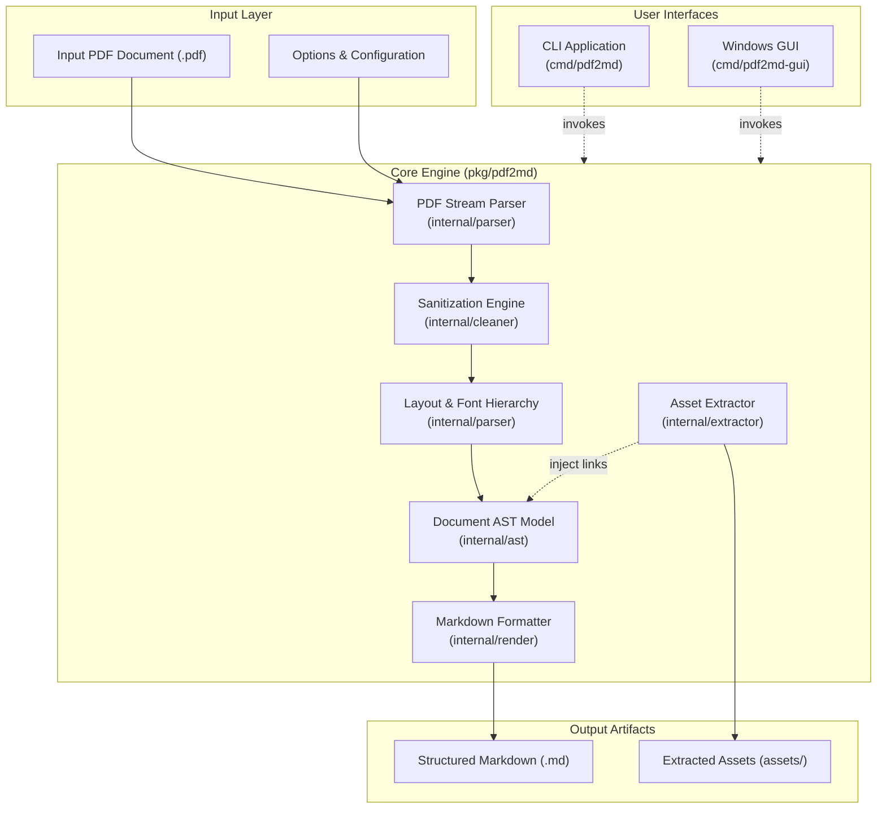

# Architecture & Design Specification: `pdf2md`

This document details the internal design, component relationships, data flow, and algorithmic foundations of the **pdf2md** engine.

---

## 1. High-Level System Architecture



---

## 2. Core Processing Pipeline

The conversion pipeline operates in six deterministic stages:

### Stage 1: Structural PDF Parsing
- Reads PDF trailer, catalog, pages, and cross-reference tables via pure Go streams without Cgo or external DLL dependencies.
- Extracts individual page content streams and font dictionaries.

### Stage 2: 2D Spatial Text Clustering & Line Assembly
- PDF text fragments possess individual 2D floating-point coordinates $(X, Y, W, H)$. In standard PDF coordinate space, $Y=0$ is at the bottom of the page and increases upward.
- `pdf2md` clusters text elements within a vertical tolerance ($|y_1 - y_2| \le 2.5\text{pt}$) into logical visual lines.
- Within each line, text chunks are sorted by horizontal coordinate $X$ ascending.
- Inter-word spacing is dynamically restored by evaluating the spatial gap: $\Delta X = X_{i+1} - (X_i + W_i)$. Gaps exceeding $1.5\text{pt}$ receive automated whitespace separators.

### Stage 3: Sanitization & Invasive Data Filtering (`internal/cleaner`)
- **Watermark Classification**: Evaluates text against a lexicon of invasive stamps (`CONFIDENTIAL`, `DRAFT`, `SAMPLE`, `PROPRIETARY`, `UNLICENSED`).
- **Margin Pagination Scrubber**: Identifies recurring headers and footers residing in the top margin ($Y > 750\text{pt}$) or bottom margin ($Y < 55\text{pt}$) matching page numbering patterns (`Page 1 of 10`, `1 / 5`, `- 1 -`).
- **Custom Pattern Redaction**: Compiles user-defined regular expressions (e.g. `\[UUID:[^\]]+\]`) to redact tracking codes or sensitive metadata before Markdown emission.

### Stage 4: Dynamic Font Hierarchy & Typography Analysis
- Hardcoding font point sizes to heading levels fails because documents use disparate type scales.
- `pdf2md` analyzes the entire document's font size distribution and determines the **modal font size** representing standard body text (typically 10pt–12pt).
- Font sizes exceeding body text by $\ge 1.0\text{pt}$ are clustered into discrete tiers sorted descending:
  - Cluster 0 $\rightarrow$ H1 (`#`)
  - Cluster 1 $\rightarrow$ H2 (`##`)
  - Cluster 2 $\rightarrow$ H3 (`###`)
- Font names and descriptors are parsed for typographic traits:
  - Bold: names containing `Bold`, `Black`, `Heavy`, `Medium`.
  - Italic: names containing `Italic`, `Oblique`, `Slanted`.
  - Code/Monospace: names containing `Courier`, `Mono`, `Code`, `Consolas`.

### Stage 5: Structural Block & Table Recognition
- **Lists**: Regular expression matching for unordered (`* `, `- `, `• `) and ordered (`1. `, `2. `) prefixes, nesting into `ast.NodeList`.
- **Code Blocks**: Continuous sequences of monospace lines are aggregated into fenced code blocks (` ``` `).
- **Blockquotes**: Lines prefixed with `> ` become `ast.NodeBlockquote`.
- **Tables**: Multi-column lines separated by horizontal gaps ($\ge 15\text{pt}$) across consecutive rows are grouped into `ast.NodeTable` and formatted with GitHub Flavored Markdown headers and alignment separators.

### Stage 6: Asset Extraction & Markdown Emission
- Raster image streams (`DCTDecode`, `FlateDecode`) are losslessly exported via `pdfcpu` into the destination assets folder (`assets/`).
- Markdown image references are linked to the AST.
- The `internal/render` emitter traverses the document AST and produces clean, GitHub Flavored Markdown.
